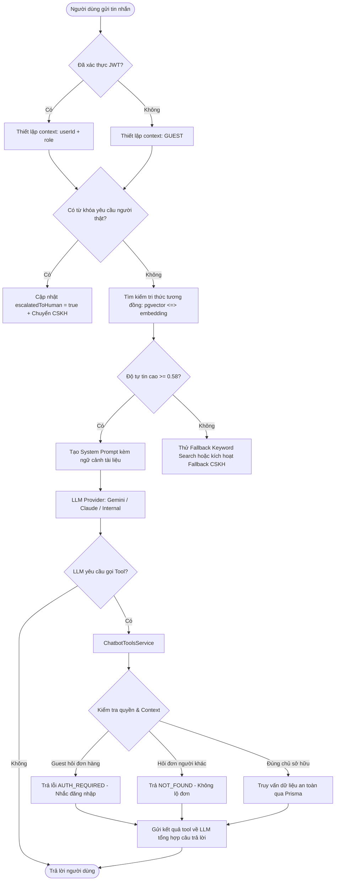
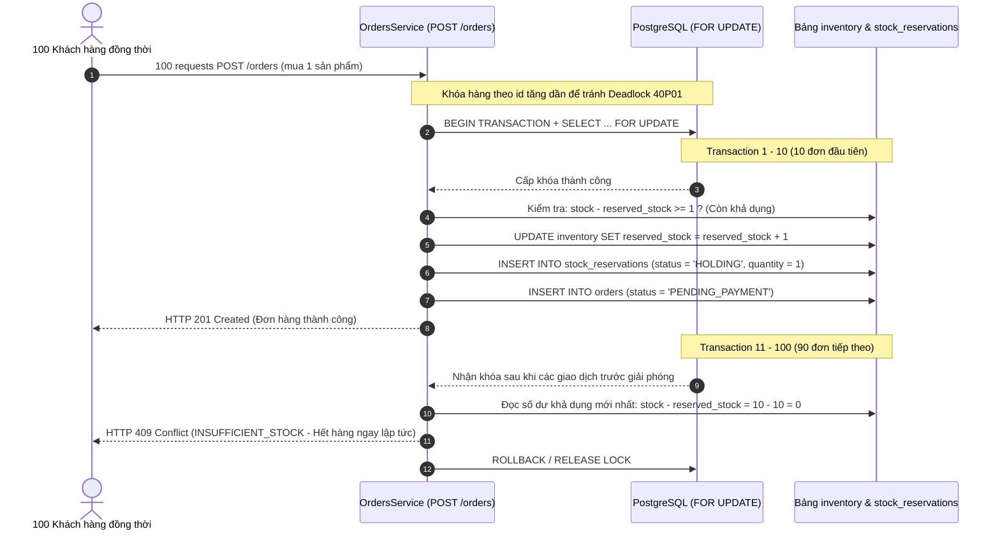

# TÀI LIỆU KỸ THUẬT VÀ HƯỚNG DẪN KIỂM THỬ ĐỘC LẬP (MINH)
**Ngày cập nhật**: 13/11/2026  
**Người thực hiện**: Minh (Phụ trách Độc lập — NFR-04.1 Load Test & Chatbot RAG Eval)

---

## 1. Danh mục Biến Môi trường Chatbot (Environment Catalog)

Trích xuất trực tiếp từ source code (`backend/src/chatbot/`):

| Tên biến | Kiểu dữ liệu | Mục đích sử dụng | Hành vi mặc định / Fallback |
|---|---|---|---|
| `VOYAGE_API_KEY` | String (API Key) | Sinh vector embedding (1024 chiều) cho chunk tri thức và câu hỏi người dùng qua Voyage AI (`voyage-3`). | Nếu thiếu hoặc lỗi 429/mạng: Tự động fallback sang tìm kiếm từ khóa toàn văn (`fallbackKeywordSearch`) trên bảng `kb_documents`. |
| `VOYAGE_MODEL` | String | Model Voyage AI sử dụng. | Mặc định: `voyage-3`. |
| `ANTHROPIC_API_KEY` | String (API Key) | Sinh câu trả lời thông minh và gọi Function Calling qua Claude (`claude-3-5-haiku-20241022`). | Nếu không có hoặc bắt đầu bằng `mock_`: Chuyển sang kiểm tra `GEMINI_API_KEY`. |
| `ANTHROPIC_MODEL` | String | Model Claude chỉ định. | Mặc định: `claude-3-5-haiku-20241022`. |
| `GEMINI_API_KEY` / `GOOGLE_API_KEY` | String (API Key) | Bộ xử lý thay thế qua Google Gemini API (`@google/genai`). | Nếu cả Claude và Gemini đều không có key: Chatbot hoạt động ở chế độ **RAG nội bộ thuần** (trả trực tiếp trích dẫn văn bản từ CSDL mà không qua LLM sinh từ). |
| `GEMINI_MODEL` | String | Model Gemini chỉ định. | Mặc định: `gemini-flash-latest`. |
| `EVAL_DELAY_MS` | Number (ms) | Giãn cách giữa các câu hỏi trong kịch bản đánh giá để tránh chạm trần RPM của gói miễn phí. | Mặc định: `0` ms (chạy liên tục). Khuyến nghị `20000` (20s) khi dùng Voyage Free Tier. |

> [!CAUTION]
> Tuyệt đối không lưu giá trị key thật vào repository. File `.env` chứa token cần được đưa vào `.gitignore`.

---

## 2. Hướng dẫn Phân biệt Các Loại Kiểm thử Chatbot

| Tiêu chí | 1. Unit Tests Cô lập (`*.spec.ts`) | 2. Evaluation Service (`chatbot-eval.ts`) | 3. HTTP E2E Test (`test/jest-e2e.json`) |
|---|---|---|---|
| **Phạm vi** | Kiểm tra từng hàm, class cô lập với mock toàn bộ dependency | Đánh giá chất lượng hội thoại RAG, độ chính xác facts, chống bịa đặt | Kiểm tra toàn diện qua giao thức HTTP/REST, Auth guard, CORS, cookie |
| **Phụ thuộc bên ngoài** | **Không** (không cần DB, không cần Redis, không cần Internet) | Cần PostgreSQL thật có bảng `kb_documents` đã seed và pgvector | Cần toàn bộ stack chạy (Backend, PostgreSQL, Redis, Mailer) |
| **Lệnh thực thi** | `npm test src/chatbot/` | `npm run eval:chatbot` | `npm run test:e2e` |
| **Thời gian chạy** | ~3 - 5 giây | ~30s - 2 phút (tùy LLM provider và delay) | ~1 - 3 phút |
| **Mục đích nghiệm thu** | Chứng minh logic thuật toán, xử lý ngoại lệ, regex, grader đạt chuẩn | Đo lường độ chính xác (Accuracy), Fallback Recall, Hallucination/Leak rate | Đảm bảo frontend/mobile gọi API thông suốt không gặp lỗi kết nối |

---

## 3. Checklist Bằng chứng Kỹ thuật (Technical Evidence Checklist)

Khi ghi nhận kết quả kiểm thử vào báo cáo, mỗi kết quả phải có đầy đủ các trường sau:

- **Git Commit SHA**: Mã commit tương ứng của lần chạy.
- **Run ID**: Định danh duy nhất của phiên kiểm thử (ví dụ: `run_1731512345_abcde`).
- **Command**: Lệnh chính xác đã chạy trong terminal.
- **Configuration**: Cấu hình môi trường (ví dụ: `initialStock=10, VUs=100, LLM=Claude-Haiku`).
- **Expected vs Actual**: Giá trị kỳ vọng so sánh trực tiếp với kết quả thu được.
- **Verdict**: Kết luận rõ ràng (`PASS`, `FAIL`, `INVALID`, `BLOCKED`).
- **Log Path / Report Path**: Đường dẫn tuyệt đối đến file log hoặc file report được sinh ra.

---

## 4. Sơ đồ Kiến trúc Thành phần (Architecture Drafts)

### 4.1. Luồng Xử lý Chatbot RAG & Phân quyền Function Calling

### 4.2. Cơ chế Chống Tranh mua Quá số lượng (Zero Oversell Invariant)

---

## 5. Danh mục Giới hạn & Điểm Chờ Tích hợp với Thành viên Khác

| Nội dung | Thành viên phụ trách | Trạng thái hiện tại | Điểm cần phối hợp khi tích hợp |
|---|---|---|---|
| **Mã lỗi chung (Error Envelope)** | Huy, Trọng | Minh dùng mã nội bộ `INSUFFICIENT_STOCK`, `AUTH_REQUIRED`, `NOT_FOUND` | Khi frontend và backend chuẩn hóa Error Envelope toàn hệ thống (F005-F006), cần cập nhật map mã lỗi tương thích. |
| **Dọn dẹp giữ hàng hết hạn (Expiration Cleanup)** | Huy, Khang | Job hiện tại dọn dẹp từng reservation lẻ | Chờ Huy chuyển sang hết hạn toàn đơn hàng (F015-F016) để cập nhật kiểm tra nhất quán. |
| **Chính sách COD & Biểu phí ship** | Trọng, Khang | Đang được đánh dấu `PENDING_POLICY` trong bộ eval cases | Cần người chốt nghiệp vụ cung cấp số liệu chính xác để cập nhật đáp án chuẩn. |
| **Chạy kiểm thử tải trên Database chung** | Cả nhóm | Minh kiểm thử hoàn toàn trên unit test mock và dataset riêng | Khi nghiệm thu đợt cuối, cả nhóm cần dành riêng 1 slot database độc lập để chạy toàn bộ 100 VUs thật và chụp ảnh dashboard. |
